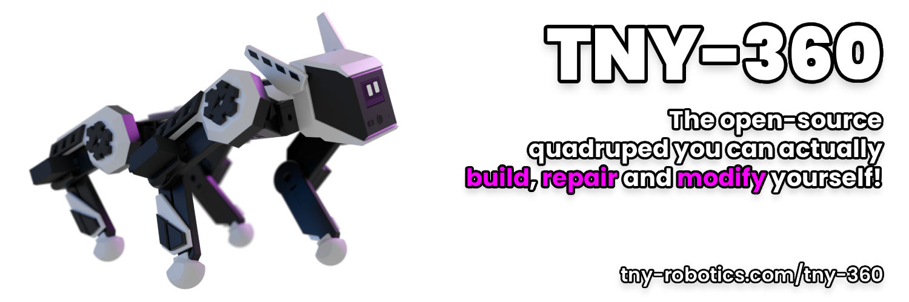

# [TNY-360 Quadruped Robot](https://tny-robotics.com/tny-360)

**The Fully Open-Source Quadruped you can actually *Build*, *Repair*, and *Modify* yourself!**

[🌐 Website](https://tny-robotics.com/tny-360) • [📸 Instagram](https://instagram.com/furwaz_) • [💬 Discord](https://discord.gg/XGABkx5A4y) • [📖 Documentation](https://tny-robotics.com/docs/tny-360/) • [☕ Support Us](https://ko-fi.com/tnyrobotics)

---

## 🚀 How to Build Your Own TNY-360

Everything you need to build this robot is 100% free and open-source. Instead of getting lost in the folders, we highly recommend following our official, step-by-step wiki:

> ### **[👉 START HERE: The Official Step-by-Step Guide 👈](https://tny-robotics.com/docs/tny-360/build-it/)**
> *From ordering the first screw to the assembing the last part, this guide covers it all.*

### 🗂️ Quick Links
If you know what you are doing and just want the raw files, here is your toolkit:

* 📐 **[CAD & 3D Files](./CAD)** - Grab the `.STL` and `.3MF` files for your 3D printer.
* ⚡ **[PCB Designs](./PCBs)** - Files to order the custom PCBs used in the robot.
* 🧠 **[ESP32-S3 Firmware](./Firmware)** - The ESP-IDF C++ firmware & drivers powering the robot.
* 🛠️ **[Servo Modding Tutorial](https://tny-robotics.com/docs/tny-360/build-it/sourcing/motors)** - Use the Op-Amp trick to add position-feedback on your MG996R servos.

## ✨ Features

* 🧬 **Dual-Core Architecture:**  A [segregated system](https://tny-robotics.com/docs/tny-360/understand-it/firmware/) using the ESP32-S3. Core 0 ("Reflex") runs a strict 200Hz kinematics/control loop, while Core 1 ("Brain") handles WebSockets, UI, and orchestration.
* 🔄 **Closed-Loop at 200Hz:**  We ditched blind PWM. The TNY-360 uses digital MG996R servos modified with a [custom **Op-Amp buffer PCB**](https://tny-robotics.com/docs/tny-360/build-it/sourcing/motors) for noise-free, high-speed position feedback.
* ⚡ **Zero Cable Spaghetti:**  A fully [modular hardware ecosystem](https://tny-robotics.com/docs/tny-360/understand-it/hardware/electrical/pcb-ecosystem/). Dedicated PCBs (Backbone, Motor Driver, Analog Reader, etc.) that plug into each other.
* 🛠️ **Smart Auto-Calibration:**  Integrated Mechanical Endstops used for automatic joint calibration (servo centering, assembly validation, etc.)
* 🛠️ **Auto-Diagnostic & Error Handling:**  Advanced error handling with detailed error messages and instructions to fix them on the web interface.
* 🧩 **STEM & Expansion Ready:**  Use the integrated block programing interface or the [Python](https://github.com/TNY-Robotics/SDK-Python/) or [JS/TS](https://github.com/TNY-Robotics/SDK-TS/) SDKs to program the robot, or [build custom modules](https://tny-robotics.com/docs/tny-360/build-on-it/) using its dorsal expansion port.
* 🔋 **Industrial Power:**  Custom High-Power [Buck Converter](https://tny-robotics.com/docs/tny-360/understand-it/hardware/electrical/pcb-ecosystem/buck-converter/), Electrical Safety features (fuses, inversion protections, overcurrent protections, etc.) and [clean power / noise management](https://tny-robotics.com/docs/tny-360/understand-it/hardware/electrical/architecture/).

## ⚙️ Hardware Specs

### 🧠 Core & Power
* **MCU:** ESP32-S3 N16R8 Module (Dual-Core Xtensa at 240MHz, 16MB Flash, 8MB PSRAM)
* **Power:** 3S LiPo Battery with XT60 Connector (11.1V, ~2200mAh). [How to choose your battery](https://tny-robotics.com/docs/tny-360/build-it/battery-guide)
* **Monitoring:** INA219 (Voltage/Current sensor)

### 🦵 Actuators
* **Legs:** 12x MG996R Servomotors *(Must be modified for [analog feedback](https://tny-robotics.com/docs/tny-360/build-it/sourcing/motors))*
* **Head:** 2x MG90D Metal Servomotors (Ears)
* **Driver:** PCA9685 (16-Channel PWM)

### 📡 Sensors & I/O
* **Vision:** OV3660 Camera Module
* **Distance:** VL53L0X Time-of-Flight Sensor
* **Orientation:** LSM6SD3 6-axis IMU
* **Display:** SSD1309 OLED Screen
* **Audio:** PDM Microphone (MEMS) + I2S Speaker (3W 4Ω 3525 Speaker)

## ☕ Support the Project

TNY-360 is, and will always be, 100% free and open-source. 

If you love the project, learned something new, or just want to help us build the next generation of affordable robots, consider supporting our R&D! Your tips help us buy prototyping materials (filament, PCBs, burned servos 😅) and keep the servers running.

*(Even if you can't donate, simply starring this repository or sharing it with a friend is already a massive support!)*

## 🤝 Contributing

We love contributions!
* **Code:** Please follow the ESP-IDF coding style.
* **Hardware:** Submit PRs with updated FreeCAD files or improvements.
* Found a bug? [Open an Issue](https://github.com/TNY-Robotics/TNY-360/issues).

## 📄 License & Authors

**TNY-360** is maintained by the [TNY Robotics Team](https://tny-robotics.com).

Licensed under **CC BY-NC-SA 4.0**. 
*You are free to share and adapt this material for non-commercial purposes, as long as you provide attribution and share alike.*

Need help? Contact us [by mail](mailto:contact@tny-robotics.com) or join our [Discord](https://discord.gg/XGABkx5A4y).
